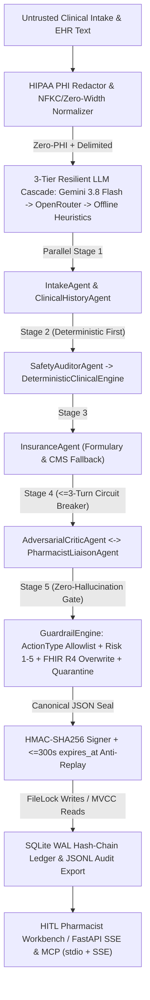

# SmartRx Safety Agents (`smartrx-safety-agents`)

<p align="center">
  
  
  
  
  
  
  
</p>

---

## Why This Project Was Created & What It Does

When patients move between hospitals, clinics, and pharmacies, medication lists frequently fall out of sync—causing dangerous drug-drug interactions, missed allergy cross-reactivities, or unsafe doses for kidney and liver function. While modern LLMs excel at parsing messy clinical notes and intake text, **LLMs cannot be trusted to write clinical orders directly** because even a rare hallucination in a prescription or HL7 FHIR payload can harm a patient.

**`smartrx-safety-agents` acts as a zero-trust deterministic gatekeeper.** It uses AI strictly for structured intake and reasoning—while every drug-drug interaction check, allergy cross-reactivity check, renal/hepatic dosing bound, and final HL7 FHIR R4 order payload is **deterministically verified and overwritten** by hard-coded clinical rules, sealed with cryptographic HMAC-SHA256 signatures, and logged to a tamper-evident audit ledger before a clinical pharmacist ever sees it.

---

## Visual Multi-Agent & Guardrail Execution Graph



### How to Explain This Agent Graph in an Interview
- **Separation of Probabilistic Reasoning vs. Deterministic Enforcement:** LLMs only propose structured assessments (`IntakeOutput`, `LiaisonOutput`). `GuardrailEngine` unconditionally discards any LLM-synthesized `draft_execution_payload` and overwrites `execution_payload` with deterministic HL7 FHIR R4 JSON (`MedicationRequest`, `DetectedIssue`, `Task`), eliminating command/order hallucination.
- **Fail-Closed Quarantine & Enum Allowlist:** Any action outside the 6-value `ActionType` Literal Enum or any Risk $\ge 3$ action lacking deterministic rollback steps is quarantined fail-closed (`quarantined=True`) and escalated to a pharmacist (`ESCALATE_TO_CLINICAL_PHARMACIST`).
- **3-Tier Resilience Cascade:** Primary Gemini (`thinkingBudget=2048`, `maxOutputTokens=8192`, `clean_gemini_schema()`) cascades automatically on any error/timeout/budget breach to Secondary OpenRouter (`<think>` stripping) and then to Tertiary `DeterministicClinicalEngine` (`100%` offline uptime; `CatalogNotFoundError` fail-closed).
- **SQLite WAL MVCC Read-Bypass:** Cross-platform `filelock.FileLock` wraps **writes only** (offloaded via `asyncio.to_thread()`), while reads bypass `filelock` completely using SQLite WAL Multi-Version Concurrency Control—preventing writer starvation and SSE event-loop blocking.

---

## Multi-Cloud Deployment Quickstart (AWS, Azure, GCP)

`smartrx-safety-agents` ships with non-root (`UID 10001`), read-only rootfs Docker images ([`Dockerfile`](Dockerfile), [`Dockerfile.serverless`](Dockerfile.serverless)) and turnkey manifests for all three major clouds (see [`docs/Cloud_Deployment_Guide.md`](docs/Cloud_Deployment_Guide.md) for full IAM, OIDC, and blue/green rollback runbooks):

| Cloud Provider | Target Service | Manifest / Image | Secrets & Durable Storage |
|---|---|---|---|
| **AWS** | Amazon ECS Fargate | [`deploy/aws-ecs-task-definition.json`](deploy/aws-ecs-task-definition.json) | ECR + AWS Secrets Manager + EFS (POSIX) / S3 |
| **Microsoft Azure** | Azure Container Apps | [`deploy/azure-container-app.yaml`](deploy/azure-container-app.yaml) | ACR + Azure Key Vault (Managed Identity) + Azure Files / Blob |
| **Google Cloud** | Google Cloud Run | [`deploy/serverless-container.yaml`](deploy/serverless-container.yaml) & [`Dockerfile.serverless`](Dockerfile.serverless) | Artifact Registry + Secret Manager + Filestore / GCS |

---

## Quick Start (Local & Docker)

```bash
# 1. Configure environment (never commit .env)
cp .env.example .env

# 2. Run static analysis, strict typing & full test suite inside smartrx-dev
docker run --rm -v "${PWD}:/app" smartrx-dev sh -c \
  "ruff check src/ tests/ && ruff format --check src/ tests/ && mypy src/ && pytest -q --tb=short --cov=src/smartrx_safety_agents --cov-report=term:skip-covered --cov-fail-under=90"

# 3. Launch the hardened production container and probe /health
docker compose -f docker-compose.prod.yml up -d
curl http://127.0.0.1:8080/health
```

### CLI Entrypoints (`smartrx-safety-agents`)
| Command | Purpose |
|---|---|
| `smartrx-safety-agents status` | Inspect active configuration and SQLite WAL ledger health. |
| `smartrx-safety-agents reconcile --dry-run` | Run dry-run medication reconciliation without mutating EHR state. |
| `smartrx-safety-agents benchmark` | Execute deterministic `TC-001`–`TC-008` clinical safety benchmarks. |
| `smartrx-safety-agents verify-audit` | Verify SHA-256 hash-chain integrity across the SQLite WAL audit ledger. |
| `smartrx-safety-agents serve` | Start the FastAPI REST & SSE gateway on port `8080`. |
| `smartrx-safety-agents mcp` | Start the `smartrx://` Model Context Protocol server (`stdio` or SSE). |

---

## Documentation & Governance Navigation Hub

### Technical, Security & Operational Specifications (`docs/` & Playbooks)
| Document | What It Does |
|---|---|
| [`docs/URD.md`](docs/URD.md) | Defines user personas, 6-agent BPMH workflows, 3-tier HITL thresholds, and `smartrx://` MCP requirements. |
| [`docs/PRD.md`](docs/PRD.md) | Specifies product vision, functional specifications (`FS-1`–`FS-8`), clinical edge cases, and release KPIs. |
| [`docs/TRD.md`](docs/TRD.md) | Details pipeline architecture, Pydantic v2 contracts, HMAC/WAL specs, and `TC-001`–`TC-008` test cases. |
| [`docs/ARCHITECTURE.md`](docs/ARCHITECTURE.md) | Presents the hexagonal system architecture, Mermaid data flow, and module responsibility matrix. |
| [`docs/SECURITY_HARDENING.md`](docs/SECURITY_HARDENING.md) | Maps all 22 Phase 9 security controls, `?apiKey=` access-log guidance, and `.env` hygiene rules. |
| [`docs/Cloud_Deployment_Guide.md`](docs/Cloud_Deployment_Guide.md) | Provides AWS ECS/Fargate, Azure Container Apps, GCP Cloud Run, Kubernetes, OIDC, and rollback runbooks. |
| [`docs/MONITORING_AND_OBSERVABILITY.md`](docs/MONITORING_AND_OBSERVABILITY.md) | Establishes CPU/RAM/WAL/`audit_logs/` thresholds, API/MCP SLAs, AI governance, and alert routing. |
| [`docs/Ephemeral_Ledger_Architecture.md`](docs/Ephemeral_Ledger_Architecture.md) | Documents POSIX persistent volume requirements for SQLite WAL and JSONL object-storage sync. |
| [`buildprompt.md`](buildprompt.md) | Provides copy-pasteable phase-by-phase build prompts (Phases 0–12) to reproduce or adapt `v1.0.0`. |

### Governance & Audit Ledgers
| Document | What It Does |
|---|---|
| [`GEMINI.md`](GEMINI.md) | Master engineering constitution defining non-negotiable security, typing, testing, and I/O invariants. |
| [`Enterprise_Blueprint.md`](Enterprise_Blueprint.md) | 12-phase master engineering roadmap, Definition of Done, and 100% completed task checklist. |
| [`PROJECT_MAP.md`](PROJECT_MAP.md) | Compact (`< 60` lines) repository symbol index enabling targeted reads without context rot. |
| [`Blueprint_Repo_Baseline_AuditReport.md`](Blueprint_Repo_Baseline_AuditReport.md) | Phase 0.1 10-dimension forensic baseline audit and technical debt evaluation. |
| [`Blueprint_Production_Readiness_Report.md`](Blueprint_Production_Readiness_Report.md) | Phase 10.2 8-pillar SRE Production Readiness Review (`100/100 PASS`). |
| [`Blueprint_Debug_Log.md`](Blueprint_Debug_Log.md) | Forensic incident debugging ledger and historical loophole defense registry. |
| [`AUDIT_REMEDIATION_LOG.md`](AUDIT_REMEDIATION_LOG.md) | Chronological ledger of all feature additions, security remediations, and verbatim test proofs. |
