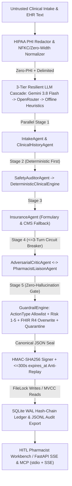

# SmartRx Safety Agents (`smartrx-safety-agents`)

<p align="center">
  
  
  
  
  
  
  
  
  
</p>

---

## Verified Engineering Scorecard

| Metric | Verified Value | Proof / Gate |
|---|---|---|
| **Passing Tests** | **60 / 60 (`100%`)** | `pytest -q --tb=short` (`smartrx-dev`) |
| **Code Coverage** | **92.84%** (`2012` stmts, `144` missed) | `pytest --cov=src/smartrx_safety_agents --cov-fail-under=90` |
| **Security & Adversarial Tests** | **14 Dedicated Tests** (`9` Phase 9 + `5` Adversarial) | [`tests/test_phase9_hardening.py`](tests/test_phase9_hardening.py), [`tests/test_adversarial_regression.py`](tests/test_adversarial_regression.py) |
| **CI/CD Token Cost** | **`$0.00` per CI Run** (`100%` Offline Deterministic) | Zero live LLM calls in CI; `httpx.MockTransport` + Tertiary Heuristics |
| **Full Suite Runtime** | **`9.79s` (`< 10s`)** | `pytest-timeout = 15s` thread gate enforced |
| **Static Analysis & Typing** | **31 Source Files (`0` Ruff / `0` Mypy Errors)** | `ruff check`, `ruff format --check`, `mypy src/` |
| **Container Footprint** | **`~208.8 MiB` (`218,954,958` bytes)** | Multi-stage `python:3.13-slim`, non-root `smartrx` (`UID 10001`), `read_only: true` |

---

## Why This Project Was Created & What It Does

When patients move between hospitals, clinics, and pharmacies, medication lists frequently fall out of sync—causing dangerous drug-drug interactions, missed allergy cross-reactivities, or unsafe doses for kidney and liver function. While modern LLMs excel at parsing messy clinical notes and intake text, **LLMs cannot be trusted to write clinical orders directly** because even a rare hallucination in a prescription or HL7 FHIR payload can harm a patient.

**`smartrx-safety-agents` acts as a zero-trust deterministic gatekeeper.** It uses AI strictly for structured intake and reasoning—while every drug-drug interaction check, allergy cross-reactivity check, renal/hepatic dosing bound, and final HL7 FHIR R4 order payload is **deterministically verified and overwritten** by hard-coded clinical rules, sealed with cryptographic HMAC-SHA256 signatures, and logged to a tamper-evident audit ledger before a clinical pharmacist ever sees it.

---

## Visual Multi-Agent & Guardrail Execution Graph



### How to Explain This Agent Graph in an Interview
- **Separation of Probabilistic Reasoning vs. Deterministic Enforcement:** LLMs only propose structured assessments (`IntakeOutput`, `LiaisonOutput`). `GuardrailEngine` unconditionally discards any LLM-synthesized `draft_execution_payload` and overwrites `execution_payload` with deterministic HL7 FHIR R4 JSON (`MedicationRequest`, `DetectedIssue`, `Task`), eliminating command/order hallucination.
- **Fail-Closed Quarantine & Enum Allowlist:** Any action outside the 6-value `ActionType` Literal Enum or any Risk $\ge 3$ action lacking deterministic rollback steps is quarantined fail-closed (`quarantined=True`) and escalated to a pharmacist (`ESCALATE_TO_CLINICAL_PHARMACIST`).
- **3-Tier Resilience Cascade:** Primary Gemini (`thinkingBudget=2048`, `maxOutputTokens=8192`, `clean_gemini_schema()`) cascades automatically on any error/timeout/budget breach to Secondary OpenRouter (`<think>` stripping) and then to Tertiary `DeterministicClinicalEngine` (`100%` offline uptime; `CatalogNotFoundError` fail-closed).
- **SQLite WAL MVCC Read-Bypass:** Cross-platform `filelock.FileLock` wraps **writes only** (offloaded via `asyncio.to_thread()`), while reads bypass `filelock` completely using SQLite WAL Multi-Version Concurrency Control—preventing writer starvation and SSE event-loop blocking.

---

## Zero-Token Deterministic Testing & Edge-Case Coverage

All 60 automated tests execute **100% offline in Python in `< 10` seconds at `$0.00` token cost**. Networked LLM calls are isolated strictly at the `httpx.MockTransport` HTTP boundary inside `MultiTierLLMClient`, while every clinical heuristic, FHIR R4 generator, HMAC-SHA256 verifier, FastAPI/MCP transport middleware, and SQLite WAL ledger runs against real, unmocked production code—eliminating LLM flakiness and API spend in CI/CD.

### Edge-Case & Adversarial Coverage Matrix

| Attack / Failure Vector | Test Suite & Exact Test | Deterministic Fail-Closed Behavior | Token Cost |
|---|---|---|---|
| **Unicode NFKC & Zero-Width Homoglyph PHI/DDI Evasion** (`"peni\u200bcillin"`, `"Ｊｏｈｎ\u200b Ｄｏｅ"`) | [`tests/test_adversarial_regression.py`](tests/test_adversarial_regression.py) (`test_adversarial_zero_width_homoglyph_bypass_blocked`, `test_adversarial_phi_redactor_blocks_homoglyph_identifiers`) | `normalize_clinical_identifier()` strips zero-width chars + NFKC folds before allergy/DDI/PHI checks; triggers `RED` `HOLD_PRESCRIPTION` & blocks PHI leak. | `$0.00` |
| **Streaming Chunked & Fast-Path >10MB Payload DoS** (`Transfer-Encoding: chunked` & `Content-Length`) | [`tests/test_phase9_hardening.py`](tests/test_phase9_hardening.py) (`test_phase9_chunked_transfer_over_10mb_returns_413`) | `PayloadSizeLimitMiddleware` (`_PayloadTooLargeError(BaseException)`) aborts streaming bodies >`10,485,760` bytes with HTTP `413` before heap buffering. | `$0.00` |
| **Cryptographic Payload Tampering & Anti-Replay TTL** (`plan_signature`, `expires_at <= 300s`, `plan_id` nonce) | [`tests/test_phase9_hardening.py`](tests/test_phase9_hardening.py) (`test_phase9_hmac_tampering_expired_ttl_replay_and_canonical_determinism`) | `GuardrailEngine.verify_plan()` rejects modified `execution_payload`, `current_time >= expires_at`, and replayed `plan_id` nonces with `PlanVerificationError`. | `$0.00` |
| **LLM Hallucinated Action Enums, Unapproved FHIR & Missing Rollbacks** (`Risk >= 3` quarantine) | [`tests/test_phase9_hardening.py`](tests/test_phase9_hardening.py) (`test_phase9_quarantine_invalid_action_and_deterministic_fhir_overwrite`) | Discards `draft_execution_payload`, quarantines invalid `ActionType` (`INVALID_ACTION_ENUM_TYPE`) or wildcard IDs (`INVALID_FHIR_IDENTIFIER`), overwrites with FHIR R4 `Bundle`. | `$0.00` |
| **Missing / Corrupted Clinical Interaction Catalog** (`config/drug_interactions.json`) | [`tests/test_phase9_hardening.py`](tests/test_phase9_hardening.py) (`test_phase9_catalog_not_found_and_tertiary_fallback_cascade`) | `load_catalog()` raises `CatalogNotFoundError` fail-closed; `/health` returns `503 degraded`; `MultiTierLLMClient` cascades cleanly to `deterministic_fallback`. | `$0.00` |
| **Missing NTI Organ-Function Labs & Boundary eGFR Thresholds** (`0.0`, `15.0`, `< 30.0`) | [`tests/test_adversarial_regression.py`](tests/test_adversarial_regression.py) (`test_adversarial_empty_medications_and_boundary_egfr_thresholds`) | Missing NTI labs trigger `REQUEST_RENAL_HEPATIC_LABS`; `eGFR 0.0` triggers `RED` `HOLD_PRESCRIPTION`; `eGFR 15.0` boundary triggers `YELLOW` `PROPOSE_THERAPEUTIC_ALTERNATIVE`. | `$0.00` |
| **Multi-Threaded SQLite WAL Read/Write Contention & Hash-Chain Integrity** (`6-thread` concurrent load) | [`tests/test_adversarial_regression.py`](tests/test_adversarial_regression.py) (`test_adversarial_concurrent_sqlite_wal_read_write_contention`) | Per-operation `FileLock` serializes writes while MVCC reads run lock-free; `AuditLedger.verify_chain_integrity()` remains `True` across 18 concurrent appends. | `$0.00` |
| **Prompt Injection Delimiters, Path Traversal & `?apiKey=` Log Redaction** | [`tests/test_phase9_hardening.py`](tests/test_phase9_hardening.py) (`test_phase9_clean_gemini_schema_defs_anyof_execution_payload_and_think_strip`, `test_phase9_sensitive_query_param_filter_redacts_api_key`) | `wrap_untrusted_data()` escapes XML delimiters; `load_prompt_module()` blocks `../` traversal; `SensitiveQueryParamFilter` masks `?apiKey=***` in `uvicorn.access`. | `$0.00` |

---

## Example Input $\to$ Deterministic Output Showcase

**1. Untrusted Input (PHI + Major DDI: Warfarin + Amiodarone):**
```json
{
  "plan_id": "plan-rx-9041",
  "raw_patient_id": "MRN-88412",
  "raw_intake_text": "Patient: Jane Doe (DOB: 1954-04-12). Start amiodarone 200 mg daily; active warfarin 5 mg daily."
}
```
- **Pre-LLM PHI Redactor Output:** `"Patient: [PHI_NAME_1] ([PHI_DOB_1]). Start amiodarone 200 mg daily; active warfarin 5 mg daily."` (zero PHI ever reaches Gemini/OpenRouter).

**2. GuardrailEngine Deterministic Output (Overwritten HL7 FHIR R4 + HMAC-SHA256 Seal):**
```json
{
  "plan_id": "plan-rx-9041",
  "patient_token": "pt_7a91c4e0b218",
  "action_type": "HOLD_PRESCRIPTION",
  "risk_score": 5,
  "risk_grade": "RED",
  "quarantined": false,
  "execution_payload": {
    "resourceType": "Bundle",
    "type": "transaction",
    "dryRun": false,
    "entry": [
      {
        "resource": {
          "resourceType": "DetectedIssue",
          "id": "ddi-11289-703",
          "status": "preliminary",
          "severity": "high",
          "patient": { "reference": "Patient/pt_7a91c4e0b218" },
          "detail": "Major DDI: Amiodarone inhibits CYP2C9/CYP3A4 warfarin metabolism, elevating INR and bleeding risk.",
          "reference": "RxNorm:11289+703 | Lexicomp Major DDI"
        }
      }
    ]
  },
  "expires_at": "2026-11-27T23:45:00Z",
  "plan_digest": "e3b0c44298fc1c149afbf4c8996fb92427ae41e4649b934ca495991b7852b855",
  "plan_signature": "9f86d081884c7d659a2feaa0c55ad015a3bf4f1b2b0b822cd15d6c15b0f00a08"
}
```

---

## Production Security, Reliability & FinOps Invariants

| Invariant Domain | Enforced Architectural Guarantee | Implementation |
|---|---|---|
| **Strict Data Contracts** | Pydantic v2 `ConfigDict(extra="forbid", frozen=True)` across all 6 agent outputs and `ActionType` Enum allowlist. | [`models/clinical.py`](src/smartrx_safety_agents/models/clinical.py) |
| **3-Tier AI Resilience** | Primary Gemini 3.8 Flash High (`8192` token cap, `clean_gemini_schema()`) $\to$ Secondary OpenRouter (`<think>` strip) $\to$ Tertiary Offline Heuristics. | [`agents/llm_client.py`](src/smartrx_safety_agents/agents/llm_client.py) |
| **RAM & FinOps Breakers** | `2048 MB` container RAM cap (`1750 MB` OOM watch drop), `500,000` session token cap, and `$10.00/day` API cost circuit breaker. | [`config.py`](src/smartrx_safety_agents/config.py) |
| **SQLite WAL Concurrency** | `PRAGMA journal_mode=WAL`, `PRAGMA user_version` migrations, per-op `FileLock` writes (`asyncio.to_thread()`), lock-free MVCC reads, 50MB/30d JSONL retention. | [`persistence/ledger.py`](src/smartrx_safety_agents/persistence/ledger.py) |
| **Zero-Trust Transport** | Timing-safe `hmac.compare_digest()` auth (`401`), dual-layer `10 MB` payload guard (`413`), non-root `UID 10001`, `read_only: true` container. | [`api/server.py`](src/smartrx_safety_agents/api/server.py), [`Dockerfile`](Dockerfile) |

---

## Multi-Cloud Deployment Quickstart (AWS, Azure, GCP)

`smartrx-safety-agents` ships with non-root (`UID 10001`), read-only rootfs Docker images ([`Dockerfile`](Dockerfile), [`Dockerfile.serverless`](Dockerfile.serverless)) and turnkey manifests for all three major clouds (see [`docs/Cloud_Deployment_Guide.md`](docs/Cloud_Deployment_Guide.md) for full IAM, OIDC, and blue/green rollback runbooks):

| Cloud Provider | Target Service | Manifest / Image | Secrets & Durable Storage |
|---|---|---|---|
| **AWS** | Amazon ECS Fargate | [`deploy/aws-ecs-task-definition.json`](deploy/aws-ecs-task-definition.json) | ECR + AWS Secrets Manager + EFS (POSIX) / S3 |
| **Microsoft Azure** | Azure Container Apps | [`deploy/azure-container-app.yaml`](deploy/azure-container-app.yaml) | ACR + Azure Key Vault (Managed Identity) + Azure Files / Blob |
| **Google Cloud** | Google Cloud Run | [`deploy/serverless-container.yaml`](deploy/serverless-container.yaml) & [`Dockerfile.serverless`](Dockerfile.serverless) | Artifact Registry + Secret Manager + Filestore / GCS |

---

## Quick Start (Local & Docker)

```bash
# 1. Configure environment (never commit .env)
cp .env.example .env

# 2. Run static analysis, strict typing & full test suite inside smartrx-dev
docker run --rm -v "${PWD}:/app" smartrx-dev sh -c \
  "ruff check src/ tests/ && ruff format --check src/ tests/ && mypy src/ && pytest -q --tb=short --cov=src/smartrx_safety_agents --cov-report=term:skip-covered --cov-fail-under=90"

# 3. Launch the hardened production container and probe /health
docker compose -f docker-compose.prod.yml up -d
curl http://127.0.0.1:8080/health
```

### CLI Entrypoints (`smartrx-safety-agents`)
| Command | Purpose |
|---|---|
| `smartrx-safety-agents status` | Inspect active configuration and SQLite WAL ledger health. |
| `smartrx-safety-agents reconcile --dry-run` | Run dry-run medication reconciliation without mutating EHR state. |
| `smartrx-safety-agents benchmark` | Execute deterministic `TC-001`–`TC-008` clinical safety benchmarks. |
| `smartrx-safety-agents verify-audit` | Verify SHA-256 hash-chain integrity across the SQLite WAL audit ledger. |
| `smartrx-safety-agents serve` | Start the FastAPI REST & SSE gateway on port `8080`. |
| `smartrx-safety-agents mcp` | Start the `smartrx://` Model Context Protocol server (`stdio` or SSE). |

---

## Documentation & Governance Navigation Hub

### Technical, Security & Operational Specifications (`docs/` & Playbooks)
| Document | What It Does |
|---|---|
| [`docs/URD.md`](docs/URD.md) | Defines user personas, 6-agent BPMH workflows, 3-tier HITL thresholds, and `smartrx://` MCP requirements. |
| [`docs/PRD.md`](docs/PRD.md) | Specifies product vision, functional specifications (`FS-1`–`FS-8`), clinical edge cases, and release KPIs. |
| [`docs/TRD.md`](docs/TRD.md) | Details pipeline architecture, Pydantic v2 contracts, HMAC/WAL specs, and `TC-001`–`TC-008` test cases. |
| [`docs/ARCHITECTURE.md`](docs/ARCHITECTURE.md) | Presents the hexagonal system architecture, Mermaid data flow, and module responsibility matrix. |
| [`docs/SECURITY_HARDENING.md`](docs/SECURITY_HARDENING.md) | Maps all 22 Phase 9 security controls, `?apiKey=` access-log guidance, and `.env` hygiene rules. |
| [`docs/Cloud_Deployment_Guide.md`](docs/Cloud_Deployment_Guide.md) | Provides AWS ECS/Fargate, Azure Container Apps, GCP Cloud Run, Kubernetes, OIDC, and rollback runbooks. |
| [`docs/MONITORING_AND_OBSERVABILITY.md`](docs/MONITORING_AND_OBSERVABILITY.md) | Establishes CPU/RAM/WAL/`audit_logs/` thresholds, API/MCP SLAs, AI governance, and alert routing. |
| [`docs/Ephemeral_Ledger_Architecture.md`](docs/Ephemeral_Ledger_Architecture.md) | Documents POSIX persistent volume requirements for SQLite WAL and JSONL object-storage sync. |
| [`buildprompt.md`](buildprompt.md) | Provides copy-pasteable phase-by-phase build prompts (Phases 0–12) to reproduce or adapt `v1.0.0`. |

### Governance & Audit Ledgers
| Document | What It Does |
|---|---|
| [`GEMINI.md`](GEMINI.md) | Master engineering constitution defining non-negotiable security, typing, testing, and I/O invariants. |
| [`Enterprise_Blueprint.md`](Enterprise_Blueprint.md) | 12-phase master engineering roadmap, Definition of Done, and 100% completed task checklist. |
| [`PROJECT_MAP.md`](PROJECT_MAP.md) | Compact (`< 60` lines) repository symbol index enabling targeted reads without context rot. |
| [`Blueprint_Repo_Baseline_AuditReport.md`](Blueprint_Repo_Baseline_AuditReport.md) | Phase 0.1 10-dimension forensic baseline audit and technical debt evaluation. |
| [`Blueprint_Production_Readiness_Report.md`](Blueprint_Production_Readiness_Report.md) | Phase 10.2 8-pillar SRE Production Readiness Review (`100/100 PASS`). |
| [`Blueprint_Debug_Log.md`](Blueprint_Debug_Log.md) | Forensic incident debugging ledger and historical loophole defense registry. |
| [`AUDIT_REMEDIATION_LOG.md`](AUDIT_REMEDIATION_LOG.md) | Chronological ledger of all feature additions, security remediations, and verbatim test proofs. |
