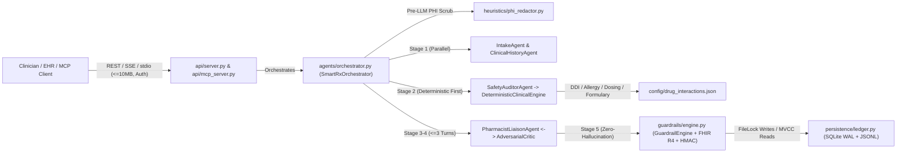
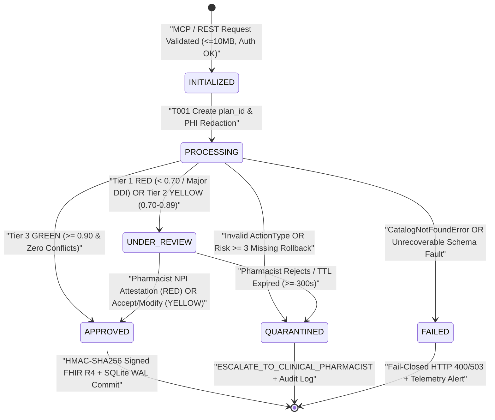
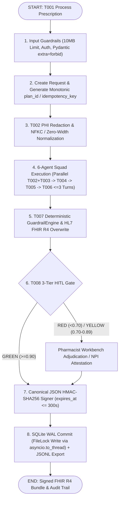

# System Architecture (`docs/ARCHITECTURE.md`)

**Project:** `smartrx-safety-agents`  
**Pattern:** Clean Modular Hexagonal Architecture + Deterministic-First Clinical Guardrails  
**Runtime:** Python 3.13+ | FastAPI + Starlette SSE + MCP (`smartrx://`) | SQLite WAL

---

## 1. High-Level Container & Pipeline Architecture

---

## 2. Module Responsibilities

| Layer | Package / File | Responsibility |
|---|---|---|
| **Configuration** | `src/smartrx_safety_agents/config.py` | Pydantic `BaseSettings`, model IDs, RAM/token/cost ceilings, fail-closed production secret checks. |
| **Data Contracts** | `src/smartrx_safety_agents/models/` | Immutable Pydantic v2 schemas (`extra="forbid"`, `frozen=True`), `ActionType` Literal Enum, NFKC + zero-width identifier normalization. |
| **Deterministic Heuristics** | `src/smartrx_safety_agents/heuristics/` | Offline `DDIEngine` (`CatalogNotFoundError`), `AllergyChecker`, `DosingValidator` (eGFR/hepatic/OCR NTI/Beer's Criteria), `FormularyChecker`, `PHIRedactor`. |
| **Guardrails & Signing** | `src/smartrx_safety_agents/guardrails/` | `GuardrailEngine` (quarantine, idempotency, HMAC-SHA256 canonical signing, `<=300s` TTL/replay), deterministic HL7 FHIR R4 (`MedicationRequest`, `DetectedIssue`, `Task`), rollback synthesis. |
| **AI Agents & Resilience** | `src/smartrx_safety_agents/agents/` | `MultiTierLLMClient` (Primary Gemini $\to$ Secondary OpenRouter `<think>` strip $\to$ Tertiary Heuristics), `clean_gemini_schema()`, 6 specialists, 3-turn `HALT_FOR_HUMAN` circuit breaker. |
| **Persistence** | `src/smartrx_safety_agents/persistence/ledger.py` | `AuditLedger` (SQLite WAL, `PRAGMA user_version` migrations, per-op `FileLock` writes, MVCC reads, SHA-256 hash chain) & `JsonlAuditExporter` (50MB rotation, 30d/500MB pruning). |
| **Transport & CLI** | `src/smartrx_safety_agents/api/`, `cli.py`, `ui/` | FastAPI REST/SSE (10MB guard, timing-safe auth, `SensitiveQueryParamFilter`), MCP `smartrx://` server, Click CLI, Streamlit HITL Workbench. |
| **Observability** | `src/smartrx_safety_agents/observability.py` | OpenTelemetry `TelemetryManager` (`.shutdown()`), `trace_span`, thread-safe `InMemoryMetricsLedger`. |

---

## 3. Request Lifecycle State Machine

---

## 4. `T001`: Process Prescription (Main Orchestration) Deep-Dive

### Task Orchestration Registry (`T001`–`T008`)

| Task ID | Task Name | Mapped Module / Agent | Execution & Safety Responsibility |
|---|---|---|---|
| `T001` | Process Prescription | `agents/orchestrator.py` (`SmartRxOrchestrator`) | Main 5-stage orchestration, `BlackboardState`, 3-turn circuit breaker, and WAL commit. |
| `T002` | Intake Prescription | `agents/specialists.py` (`IntakeAgent`), `heuristics/phi_redactor.py` | Pre-LLM PHI scrubbing, Unicode NFKC normalization, and RxNorm RxCUI / OCR extraction. |
| `T003` | Retrieve Patient History | `agents/specialists.py` (`ClinicalHistoryAgent`) | Parallel longitudinal EHR medication, allergy, and eGFR/CrCl/hepatic lab consolidation. |
| `T004` | Safety Audit | `agents/specialists.py` (`SafetyAuditorAgent`), `heuristics/engine.py` | Deterministic-first DDI, allergy cross-reactivity, Beer's Criteria, and NTI dosing bounds. |
| `T005` | Insurance Check | `agents/specialists.py` (`InsuranceAgent`), `heuristics/formulary_checker.py` | Formulary coverage check, Prior Authorization detection, and CMS therapeutic fallback. |
| `T006` | Generate Summary | `agents/specialists.py` (`PharmacistLiaisonAgent`, `AdversarialAuditorAgent`) | Structured clinical summary synthesis and `<= 3`-turn adversarial safety verification. |
| `T007` | Validate Output | `guardrails/engine.py` (`GuardrailEngine`), `guardrails/fhir_generator.py` | `ActionType` allowlist, Risk 1–5 scoring, FHIR R4 overwrite, quarantine & HMAC-SHA256 signing. |
| `T008` | Human Review | `ui/dashboard.py`, `api/server.py` (`/api/v1/adjudicate`) | 3-Tier HITL Pharmacist Workbench (RED NPI attestation, YELLOW review/modify, GREEN auto-log). |
